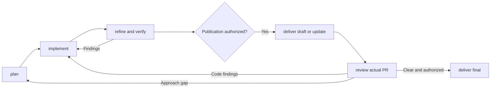

# skvoll/skills

Portable workflows installed with the [Vercel Skills CLI](https://github.com/vercel-labs/skills).

## Install

Use Node.js 22.20 or newer. In the target project:

```sh
npx skills add skvoll/skills
```

Install all skills for Codex and Claude Code without prompts:

```sh
npx skills add skvoll/skills --skill '*' --agent codex claude-code --yes
```

Use `--global` for user-wide scope, `--list` to preview, `--skill <name>` to select,
and `--copy` instead of links. Installation copies skill directories and creates
agent links/copies; it adds no global instructions, MCP servers, or configuration.

## Use

Start with `$orc <context>` in Codex or `/orc <context>` in Claude Code. Supply a
ticket, brief, detailed request, or existing run. Install `orc` with all five
`orc-*` stages; stages also return standalone results.

| Skill | Outcome |
| --- | --- |
| `pact` | Shared rules embedded in project instructions |
| `orc` | Coordinates development, authorized delivery, review, and repairs |
| `orc-plan` | Grounded plan, criteria/checks, unresolved decisions |
| `orc-implement` | Verified local implementation or repair |
| `orc-refine` | Fresh goal/architecture review, corrections, coverage/performance evidence |
| `orc-deliver` | Approved draft publication, same-PR update, or final promotion |
| `orc-review` | Fresh PR analysis plus existing feedback and current checks |
| `browser-check` | Local/deployed browser verification through available Chrome MCP/Chrome DevTools MCP |
| `onboard` | Source-backed maintainer lesson; optional subsystem focus |
| `explain` | Concise explanations and handoffs |
| `git-prune` | Confirmed local branch/worktree cleanup; read-only preview |



Local work proceeds from grounded requirements. Consequential unknowns need user
decisions. Staging, commits, branch/worktree changes, pushes, PR writes, and other
uncovered effects need explicit scope. Reuse covering grants; one publication
approval covers no later effects unless stated. Handoff means ready for human
review, not merged.

Before delegation, `orc` checks relevant repository/organization/user skills.
Generic `explain` handles communication; conditional `browser-check` handles local
and revision-matched deployed checks. Stages retain direct fallbacks. Other skills
require approval of exact source, role, use, dependencies, and effects; descendants
inherit it. Selection waives no verification or delivery gate.
Missing needed browser tooling requires agreed setup, never automatic installation.
Standalone PR review discovers previews and runs the same checks without `orc`.

The host supplies skills/fresh contexts. Missing capabilities or required
evidence block affected work. Local checkpoints support resumption, not a
scheduler or execution after the session ends. Reading/editing/installing a
skill does not invoke it; no adapter/configuration change is required.

`orc` owns observation: events or finite snapshots deliver findings promptly
while CI remains pending. Polling defaults to 30 seconds and a ten-minute
ceiling, with progress each minute. Standalone observation reports; authorized
repairs/publication remain controller-owned.

Manage installations with `npx skills list`, `npx skills update`, and `npx skills remove <name>`;
add `--global` for that scope. `orc` replaces `orchestrate`; `orc-*` replaces
`orch-*`, and former `task`, `refine`, and `deliver` names are retired. Updating
source removes no legacy installation: inspect and remove only confirmed old
`skvoll/skills` copies before reinstalling.

## Develop

Read [AGENTS.md](AGENTS.md). Every skill addition/change must pass the
[authoring process](docs/instruction-authoring.md), including full readback,
deduplication, context counts, and validation. Each `skills/<name>` installs
independently; root/docs guidance does not install. [Pact's source](skills/pact/assets/rules.md)
updates embedded rules only after updating the installation and rerunning pact.

## License

UNLICENSED. All rights reserved.
