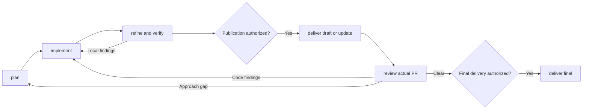

# skvoll/skills

Portable agent workflows, installed with the [Vercel Skills CLI](https://github.com/vercel-labs/skills).

## Install

Use Node.js 22.20 or newer. In the target project:

```sh
npx skills add skvoll/skills
```

To install every skill for Codex and Claude Code without prompts:

```sh
npx skills add skvoll/skills --skill '*' --agent codex claude-code --yes
```

Add `--global` for user-wide installation. Preview with `--list`; select with
`--skill <name>`. Installation copies skill directories and creates agent links
(or copies with `--copy`), not global instructions, MCP servers, or configuration.

## Use

Start with `$orc <context>` in Codex or `/orc <context>` in
Claude Code. Context can be a ticket, short description, detailed prompt, or
an existing run to resume.

| Skill | Outcome |
| --- | --- |
| `pact` | Shared rules embedded in project instructions. |
| `orc` | Coordinates local development, approved draft delivery, PR review, repairs, and final handoff. |
| `orc-plan` | A grounded plan, acceptance criteria, checks, and explicit unresolved decisions. |
| `orc-implement` | A verified local implementation or repair, with evidence and remaining findings. |
| `orc-refine` | Fresh review against task goals, architecture checks, local corrections, and performance assessment. |
| `orc-deliver` | Approved draft publication, updates to the same PR, or final promotion. |
| `orc-review` | Fresh PR reviews combined with bot/human feedback and current-revision check evidence. |
| `onboard` | A source-backed maintainer lesson; optionally focus on a subsystem. |
| `explain` | Clear explanations and human-facing handoffs. |
| `git-prune` | Confirmed local branch/worktree cleanup; `preview` inspects only. |

Install `orc` with all five `orc-*` stages. Stages also work
independently and return to their caller. `explain` remains a generic skill;
plans, substantial questions, and reports use it when available, with a concise
standalone fallback. Simple questions can be asked directly.

Before delegating a stage, the orchestrator checks relevant repository,
organization, and user skills. It can propose a specialized helper, such as a
component generator or preview procedure, or a full stage replacement. It shows
the exact source, purpose, and effects and asks before invocation. Approval is
scoped and passed to subagents; it does not waive verification or delivery gates.
The established generic `explain` helper remains part of the default pipeline.

The orchestrated flow is:



Local work continues from grounded requirements; consequential unknowns return
to the user. Staging, commits, pushes, PR writes, and other side effects require
explicit scope. A draft approval covers only the stated operation; broader
authorization can cover later actions without repeated questions. The final
handoff is a PR ready for human review, not a merge.

The workflow uses the host's existing skill and fresh-agent capabilities. It
keeps local run checkpoints and stops on missing capabilities, required evidence,
or authorization. Checkpoints support resumption; these instructions do not
install a scheduler or promise execution after the host session ends.

`orc` supervises PR observation. Available events or finite snapshots
return feedback promptly; pending CI does not delay triage of a new comment.
When polling is needed, defaults are 30 seconds between observations and a
ten-minute deadline, with progress at least once a minute. The deadline limits
waiting; it does not delay findings. Standalone observation reports findings;
the orchestrator owns authorized repairs and approval-gated publication.

Read a skill for its procedure and permissions. Reading, installing, or editing
one does not invoke it. No adapter or user-configuration change is required.

Manage installations with `npx skills list`, `npx skills update`, and
`npx skills remove <name>`. Add `--global` for global installations.

`orc` is the working name for this workflow. It replaces `orchestrate`; stages
use `orc-*` instead of `orch-*`. The former `task`, `refine`, and `deliver` names
are also retired. `task` is split between orchestration, planning, and
implementation. Updating this checkout does not remove installed legacy copies.
Inspect `npx skills list` and remove only confirmed old `skvoll/skills` copies in
the appropriate scope before reinstalling the renamed workflows.

## Develop

Read [AGENTS.md](AGENTS.md). Each skill is independently installed from
`skills/<name>/SKILL.md`; support files stay inside its directory.
[Authoring rules](docs/instruction-authoring.md) define wording and validation.
[Pact's rules](skills/pact/assets/rules.md) are the shared-policy source; update
its installation and rerun pact to apply future changes to another project.
Maintainer docs under `docs/` are not installed.

## License

UNLICENSED. All rights reserved.
